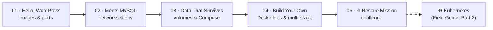

<p align="center"></p>

<p align="center">
  <a href="https://varoonsahgal.github.io/docker-k8s-labs/field-guide/"></a>
  
  
</p>

> Five hands-on labs that take you from **"what's an image?"** to **debugging a broken multi-container stack under pressure**, plus a beautifully illustrated **[Field Guide](https://varoonsahgal.github.io/docker-k8s-labs/field-guide/)** that explains every concept and shows where it all leads in Kubernetes. 🐳 ➡️ ☸️

---

## 🗺️ The voyage

| # | Lab | You'll learn | Time | Style |
|:-:|---|---|:-:|:-:|
| 01 | [🐳 **Hello, WordPress**](labs/01-hello-wordpress/README.md) | Images vs. containers, `docker run`, port mapping, one image → many containers | 30 min | Guided |
| 02 | [🗄️ **WordPress Meets MySQL**](labs/02-wordpress-meets-mysql/README.md) | Networks, container DNS, environment variables, `docker exec` | 40 min | Challenge mode |
| 03 | [💾 **Data That Survives**](labs/03-volumes-and-compose/README.md) | Volumes, bind mounts, Docker Compose, `.env`, healthchecks, restart policies | 60 min | Guided + solo |
| 04 | [🏗️ **Build Your Own Image**](labs/04-build-your-own-image/README.md) | Dockerfiles, layer caching, `.dockerignore`, multi-stage builds, non-root, `ARG`/`ENV`, replicas | 75 min | Guided + solo |
| 05 | [🔥 **Rescue Mission**](labs/05-challenge-rescue-mission/README.md) | *Everything*: debug a broken stack, prove persistence, add staging, scale out, slim a 1.2 GB image | 90 min | Hints only 🏆 |



---

## 📘 The Field Guide

**👉 [varoonsahgal.github.io/docker-k8s-labs/field-guide](https://varoonsahgal.github.io/docker-k8s-labs/field-guide/)**

A single-page handout with 29 chapters, original diagrams, analogies, "trap" warnings and a searchable glossary. It covers:

- **Ground school:** why containers exist, containers vs. VMs
- **Docker:** images, registries, `docker run`, ports, env vars, networks, volumes, Dockerfiles, multi-stage builds, Compose, healthchecks, image hygiene
- **Kubernetes:** cluster architecture, desired state, Pods, Deployments, Services, Ingress, ConfigMaps & Secrets, storage, probes, and a *Compose → Kubernetes* translation table
- **Reference:** troubleshooting, a copy-paste crib sheet, glossary A–Z

Keep it open in a tab next to the labs. It works on phones and has a dark mode.

---

## 🧰 Before you start

1. **Install Docker Desktop** (Mac/Windows) or Docker Engine + Compose plugin (Linux): <https://docs.docker.com/get-docker/>
2. **Check it works:**
   ```bash
   docker version
   docker compose version
   docker run hello-world
   ```
3. **Clone this repo** (Labs 04 and 05 use files from it):
   ```bash
   git clone https://github.com/varoonsahgal/docker-k8s-labs.git
   cd docker-k8s-labs
   ```
4. **Optional, but kind to the Wi-Fi:** pre-pull the big images the night before:
   ```bash
   docker pull wordpress:latest
   docker pull wordpress:7.1-php8.3-apache
   docker pull mysql:latest
   docker pull mysql:8.4
   docker pull golang:1.23-alpine
   docker pull python:3.12-alpine
   ```

> [!TIP]
> On Windows, use **PowerShell** or **WSL 2**. Where the labs show a trailing `\` for multi-line commands, PowerShell uses a backtick `` ` `` instead (or put the command on one line).

---

## 📁 What's in here

```text
docker-k8s-labs/
├── labs/
│   ├── 01-hello-wordpress/
│   ├── 02-wordpress-meets-mysql/
│   ├── 03-volumes-and-compose/
│   ├── 04-build-your-own-image/
│   │   ├── whoami/        ← tiny Go web server you'll containerise
│   │   └── badge/         ← WordPress plugin you'll bake into an image
│   └── 05-challenge-rescue-mission/
│       └── starter/       ← the broken stack 🔥 + a bloated image to fix
├── field-guide/           ← the illustrated handout (GitHub Pages)
└── assets/                ← banners
```

---

## 🙋 Stuck?

1. Re-read the step, especially the **⚠️ / 💡 callouts**
2. Check the [Field Guide's troubleshooting chapter](https://varoonsahgal.github.io/docker-k8s-labs/field-guide/#trouble)
3. `docker ps -a`, `docker logs <name>` and `docker compose ps` answer most questions
4. Ask your neighbour, then your instructor 🙂

Happy shipping! 🚢
