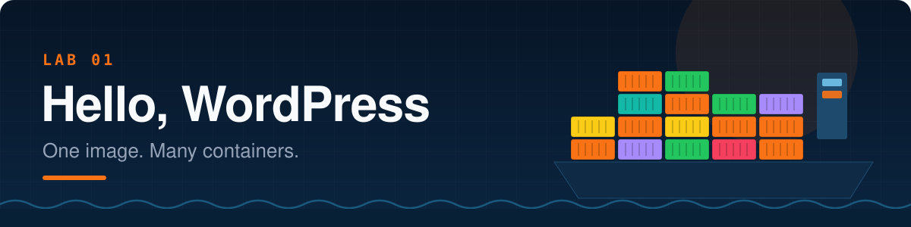
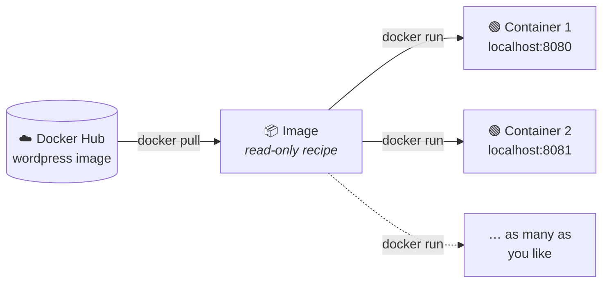
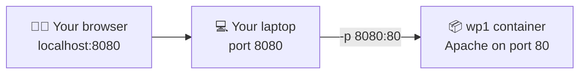
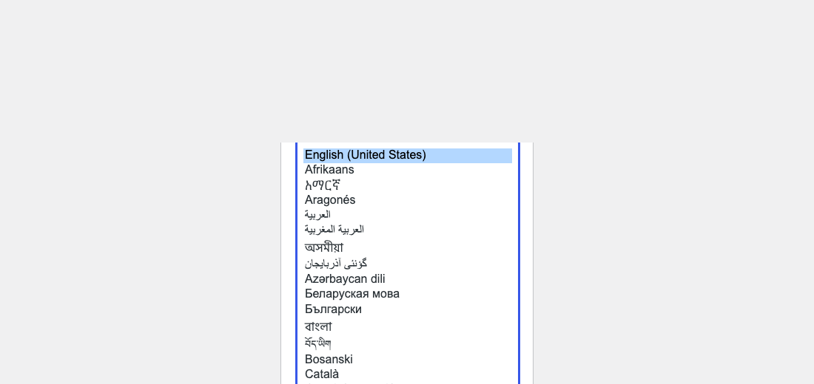

<p align="center"></p>

<p align="center">
  
  
  
</p>

> **The best way to understand Docker is to play with it.** In the next 30 minutes you'll launch a full WordPress website without installing PHP, Apache or anything else. Then you'll launch a *second* one. Then you'll understand why Kubernetes exists.

<br>

## 🎯 Mission brief

| | You will… |
|---|---|
| 🐳 | **Pull** a real image from Docker Hub |
| 🚀 | **Run** it as a container with a **port mapping** |
| 🌐 | **See** WordPress in your browser |
| 👯 | **Clone** it: a second container from the *same* image on a *different* port |
| 💥 | **Break** something on purpose (and learn from the error) |

> [!TIP]
> Keep the **[Docker & Kubernetes Field Guide](https://varoonsahgal.github.io/docker-k8s-labs/field-guide/)** open in another tab. Every concept in this lab has an entry there with diagrams.

---

## 🧠 The one idea to hold onto

An **image** is a recipe. A **container** is a dish made from that recipe.



You never "run an image" directly. You run an image **to get** a container. One recipe, unlimited dishes, and each dish is independent: eat one and the others are untouched.

---

## ✅ Step 0 · Pre-flight check

Make sure Docker is alive:

```bash
docker version
docker run hello-world
```

You should see **"Hello from Docker!"**. If you get *"Cannot connect to the Docker daemon"*, start Docker Desktop and wait for the whale 🐳 in your menu bar to stop animating.

---

## 📖 Step 1 · Read the label on the box

Open the official image page: **<https://hub.docker.com/_/wordpress>**

Skim it like a detective 🔍. Find answers to these (you'll need them):

- [ ] Which **port** does WordPress listen on *inside* the container?
- [ ] What does the `_` in the URL `/_/wordpress` mean? *(Hint: look for the "Docker Official Image" badge.)*
- [ ] Find the **Supported tags** list. What tag do you get if you don't specify one?

<details>
<summary>🔓 Check your answers</summary>

- Port **80**. Apache inside the image listens on the standard HTTP port.
- `_` is the "library" namespace, home of **Docker Official Images** that are curated and security-scanned by Docker.
- `latest`. Typing `wordpress` is the same as typing `wordpress:latest`.

</details>

---

## 📥 Step 2 · Pull the image

```bash
docker pull wordpress
```

Watch the output: Docker downloads several **layers** in parallel (those lines ending in `Pull complete`). An image is a stack of layers, and layers are shared between images, so the next image that uses the same base downloads faster.

Now see what you've got:

```bash
docker images wordpress
```

```text
REPOSITORY   TAG       IMAGE ID       CREATED       SIZE
wordpress    latest    3f2a9c1b8d7e   2 days ago    795MB
```

> [!NOTE]
> Nothing is *running* yet. An image just sits on disk, like a recipe in a drawer. Prove it with `docker ps`: the list is empty.

---

## 🚀 Step 3 · Run your first WordPress container

```bash
docker run -d --name wp1 -p 8080:80 wordpress
```

Let's decode that spell 🪄:

| Piece | Meaning |
|---|---|
| `docker run` | Create **and** start a container from an image |
| `-d` | **Detached**: run in the background and give me my terminal back |
| `--name wp1` | A friendly name, so you don't have to type `a3f9c2e1b7d4` |
| `-p 8080:80` | **Port mapping**: `HOST:CONTAINER`. Traffic to *your* port 8080 → the container's port 80 |
| `wordpress` | The image to use (`:latest` is implied) |



Check it's alive:

```bash
docker ps
```

```text
CONTAINER ID   IMAGE       COMMAND                  STATUS         PORTS                  NAMES
a3f9c2e1b7d4   wordpress   "docker-entrypoint.s…"   Up 5 seconds   0.0.0.0:8080->80/tcp   wp1
```

See that `0.0.0.0:8080->80/tcp`? That's your port mapping, confirmed. ✅

---

## 🌐 Step 4 · Open it in your browser

Go to 👉 **<http://localhost:8080>**

You should be greeted by the WordPress language picker:

<p align="center"></p>

🎉 **You just ran a full PHP + Apache web application without installing either.** Everything it needs lives inside the container.

> [!IMPORTANT]
> Click **Continue** and you'll hit a page asking for **database details**. Don't fill it in! WordPress needs a MySQL database, and this container doesn't have one. That's exactly what **Lab 02** fixes. For now, landing on the installer is victory.

---

## 👯 Step 5 · Same image, second container

While `wp1` is still running, launch a twin:

```bash
docker run -d --name wp2 -p 8081:80 wordpress
```

Open 👉 **<http://localhost:8081>**: a second, completely independent WordPress.

```bash
docker ps
```

```text
CONTAINER ID   IMAGE       STATUS          PORTS                  NAMES
9b8e7f6a5c4d   wordpress   Up 3 seconds    0.0.0.0:8081->80/tcp   wp2
a3f9c2e1b7d4   wordpress   Up 2 minutes    0.0.0.0:8080->80/tcp   wp1
```

Notice:

- **Same image** (`wordpress`), two containers.
- **Same container port** (`80`) in both, no conflict, because each container has its own private network stack.
- **Different host ports** (`8080`, `8081`), because your laptop only has *one* port 8080.

> [!TIP]
> **Kubernetes preview 🔮.** "Run N identical copies of one image" is the heart of Kubernetes. In K8s you'll write `replicas: 3` and it'll do this for you, across many machines, and replace any copy that dies.

---

## 💥 Step 6 · Break it on purpose

Try to start a third container on a port that's already taken:

```bash
docker run -d --name wp3 -p 8080:80 wordpress
```

```text
docker: Error response from daemon: driver failed programming external connectivity
on endpoint wp3: Bind for 0.0.0.0:8080 failed: port is already allocated.
```

🧠 **Read the error.** Docker *created* `wp3` but couldn't *start* it, because host port 8080 belongs to `wp1`. Look:

```bash
docker ps -a --filter name=wp3
```

Its status is `Created`, not `Up`. Clean up the casualty:

```bash
docker rm wp3
```

---

## 🔬 Step 7 · Poke around (bonus XP)

Try each command and figure out what it tells you:

```bash
docker logs wp1               # Apache's access log. Refresh the browser and run it again!
docker logs -f wp1            # follow mode (Ctrl+C to exit)
docker stats --no-stream      # CPU and memory per container
docker exec -it wp1 bash      # open a shell INSIDE the container 🤯
```

Inside the container shell, try:

```bash
hostname          # it's the container ID!
ls /var/www/html  # the WordPress files
cat /etc/os-release
exit
```

> [!NOTE]
> Your laptop might be macOS or Windows, but `/etc/os-release` says **Debian**. Containers share the host's Linux kernel; on a Mac or PC, Docker Desktop quietly runs a small Linux VM to provide one.

---

## 🧹 Step 8 · Clean up

```bash
docker stop wp1 wp2     # graceful shutdown
docker rm wp1 wp2       # delete the containers
docker ps -a            # they're gone
docker images           # the image is still here, ready for next time
```

> [!TIP]
> Shortcut: `docker rm -f wp1 wp2` stops and removes in one go.

---

## 🏁 Checkpoint

You're done when you can tick every box:

- [ ] I pulled `wordpress` and saw it in `docker images`
- [ ] I ran it with `-p` and saw the installer at `localhost:8080`
- [ ] I ran a second container on `localhost:8081` at the same time
- [ ] I triggered and understood *"port is already allocated"*
- [ ] I can explain the difference between an image and a container to a friend

## 🤔 Quick quiz

<details>
<summary><b>1.</b> You run <code>docker run -p 9000:80 wordpress</code>. Which URL do you open?</summary>

`http://localhost:9000`. The **left** number is always your machine (host); the right number is inside the container.
</details>

<details>
<summary><b>2.</b> You delete a container. Is the image deleted too?</summary>

No. Images and containers have separate lifecycles. Remove an image with `docker rmi wordpress` (only works if no container is using it).
</details>

<details>
<summary><b>3.</b> Why can two containers both use port 80, but not both use host port 8080?</summary>

Each container gets its own isolated network namespace, with its own "port 80". But your laptop has exactly one network stack, so host port 8080 can only be bound once.
</details>

---

<p align="center">
  <b>Next up →</b> <a href="../02-wordpress-meets-mysql/README.md"><b>Lab 02 · WordPress Meets MySQL</b></a>: give WordPress a database and actually publish a post.
</p>
