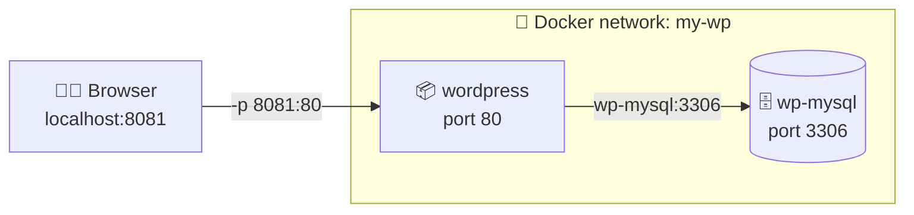
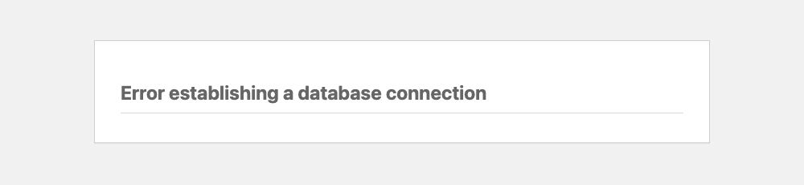

<p align="center"></p>

<p align="center">
  
  
  
</p>

> **Challenge mode! 🎮** In Lab 01 your WordPress got as far as *"please enter your database details"* and then stalled. Today you give it a real MySQL database, wire the two containers together on a private network, and publish your first post.

<br>

## 🎯 Mission brief

| | You will… |
|---|---|
| 🛜 | Create a **Docker network** so containers can talk |
| 🗄️ | Run **MySQL** configured entirely with **environment variables** |
| 🔗 | Point WordPress at MySQL **by container name** (container DNS!) |
| ✍️ | Finish the install and **publish a post** |
| 🔎 | Peek inside the database with `docker exec` |
| 💀 | Discover the uncomfortable truth about where your data lives |

---

## 🧠 The big picture



Two containers, one private network. Only WordPress is exposed to your laptop. MySQL is reachable **only** from inside `my-wp`, which is exactly what you want for a database.

---

## 🧹 Step 0 · Clean slate

Leftovers from Lab 01 can hog ports. Clear them:

```bash
docker rm -f wp1 wp2 2>/dev/null; docker ps
```

---

## 🛜 Step 1 · Build the private network

**Containers are isolated by default.** Two containers started separately can't find each other by name. Put them on a shared **user-defined network**:

```bash
docker network create my-wp
docker network ls
```

> [!NOTE]
> **Why not the default network?** Docker has a built-in `bridge` network, but containers on it can only reach each other by IP address. A network *you* create comes with a built-in **DNS server**: every container can reach every other one **by name**. That's the magic that makes Step 3 work.

---

## 🗄️ Step 2 · Launch MySQL

```bash
docker run --name wp-mysql \
  -e MYSQL_ROOT_PASSWORD=root \
  -e MYSQL_DATABASE=wp \
  -e MYSQL_USER=user \
  -e MYSQL_PASSWORD=admin \
  --net=my-wp \
  -d mysql:latest
```

> [!TIP]
> On Windows PowerShell, replace each trailing `\` with a backtick `` ` ``, or just put the whole command on one line.

| Flag | What it does |
|---|---|
| `-e MYSQL_ROOT_PASSWORD=root` | Sets the superuser password (required by the image) |
| `-e MYSQL_DATABASE=wp` | Creates an empty database called `wp` on first boot |
| `-e MYSQL_USER=user` / `-e MYSQL_PASSWORD=admin` | Creates a regular user with full access to `wp` |
| `--net=my-wp` | Joins the private network |
| `-d mysql:latest` | Runs detached, using the `latest` tag |

**Environment variables (`-e`) are how you configure containers.** No config files to edit, no installers to click through. The image's documentation lists every variable it understands. Go look: <https://hub.docker.com/_/mysql> → *Environment Variables*.

MySQL takes ~15–30 seconds to initialise on first boot. Watch it happen:

```bash
docker logs -f wp-mysql
```

Wait for `ready for connections. Version: ...`, then hit **Ctrl+C**.

---

## 📦 Step 3 · Launch WordPress, pointed at MySQL

```bash
docker run --name wordpress \
  -e WORDPRESS_DB_HOST=wp-mysql:3306 \
  -e WORDPRESS_DB_USER=user \
  -e WORDPRESS_DB_PASSWORD=admin \
  -e WORDPRESS_DB_NAME=wp \
  --net=my-wp \
  -p 8081:80 \
  -d wordpress:latest
```

🔍 **Look closely at `WORDPRESS_DB_HOST=wp-mysql:3306`.** That's not an IP address. It's the **name of the MySQL container**. Docker's DNS on `my-wp` turns `wp-mysql` into the right IP automatically.

🔗 Notice how the values line up across the two containers:

| MySQL container | | WordPress container |
|---|:-:|---|
| `--name wp-mysql` | ➡️ | `WORDPRESS_DB_HOST=wp-mysql:3306` |
| `MYSQL_DATABASE=wp` | ➡️ | `WORDPRESS_DB_NAME=wp` |
| `MYSQL_USER=user` | ➡️ | `WORDPRESS_DB_USER=user` |
| `MYSQL_PASSWORD=admin` | ➡️ | `WORDPRESS_DB_PASSWORD=admin` |

Mismatch any one of these and you'll meet this old friend:

<p align="center"></p>

> [!NOTE]
> Seeing that error in the **first ~20 seconds** is normal if MySQL is still booting. Refresh after a moment. If it *stays*, check the table above for typos.

---

## ✍️ Step 4 · Finish the install and publish!

1. Open 👉 **<http://localhost:8081>**
2. Pick your language → **Continue**
3. Notice it **skipped the database screen** this time. The env vars already answered it. 😎
4. Fill in a site title (go wild: *"Containers & Coffee"* ☕), username, password, email
5. **Install WordPress** → **Log In**
6. Go to **Posts → Add New**, write something, and hit **Publish** 🎉

Visit <http://localhost:8081> again. Your post is live, served by one container, stored in another.

---

## 🔎 Step 5 · Look inside the database

Prove your post really lives in MySQL. Run a SQL query **inside** the `wp-mysql` container:

```bash
docker exec -it wp-mysql mysql -uuser -padmin wp \
  -e "SELECT ID, post_title, post_status FROM wp_posts WHERE post_type='post';"
```

```text
+----+------------------------------+-------------+
| ID | post_title                   | post_status |
+----+------------------------------+-------------+
|  1 | Hello world!                 | publish     |
|  5 | My first containerised post  | publish     |
+----+------------------------------+-------------+
```

`docker exec` runs a command in an **already-running** container. It's your universal debugging tool.

Now inspect the network to see both containers and their IPs:

```bash
docker network inspect my-wp --format '{{range .Containers}}{{.Name}} → {{.IPv4Address}}{{"\n"}}{{end}}'
```

---

## 🧪 Step 6 · Experiments (try to predict before you run!)

**🧪 A: Prove the DB is private.** MySQL listens on 3306, but we never used `-p`. Can your laptop reach it?

```bash
nc -zv localhost 3306      # macOS / Linux
# Windows: Test-NetConnection localhost -Port 3306
```

<details><summary>What happened & why</summary>

Connection refused (unless you have MySQL installed locally). No `-p` means no door from your laptop into that container. Only containers on `my-wp` can reach it. That's good security by default.
</details>

**🧪 B: Container DNS from the inside.**

```bash
docker exec wordpress getent hosts wp-mysql
```

<details><summary>What happened & why</summary>

You see the private IP of `wp-mysql`, resolved by Docker's embedded DNS server on the user-defined network.
</details>

**🧪 C: Off the network.** Run a throwaway container that is **not** on `my-wp` and try the same lookup:

```bash
docker run --rm wordpress:latest getent hosts wp-mysql || echo "🙈 can't see it!"
```

<details><summary>What happened & why</summary>

Nothing resolves. Different network, different world. Isolation is the default; sharing is opt-in.
</details>

---

## 💀 Step 7 · The uncomfortable truth

Your post is stored in `/var/lib/mysql` **inside the `wp-mysql` container's writable layer**. Watch what happens when that container goes away:

```bash
docker rm -f wp-mysql
docker run --name wp-mysql -e MYSQL_ROOT_PASSWORD=root -e MYSQL_DATABASE=wp \
  -e MYSQL_USER=user -e MYSQL_PASSWORD=admin --net=my-wp -d mysql:latest
```

Wait ~20 seconds and refresh <http://localhost:8081>.

😱 **WordPress wants to be installed again.** Your site, your post: gone.

> [!CAUTION]
> **Containers are disposable. Data inside them dies with them.** This is a feature (clean, reproducible environments) but it means databases need **volumes**. That's the first thing you'll fix in **Lab 03**.

---

## 🧹 Clean up

```bash
docker rm -f wordpress wp-mysql
docker network rm my-wp
```

---

## 🏁 Checkpoint

- [ ] I created a user-defined network and explained why it's needed
- [ ] I configured MySQL purely with `-e` environment variables
- [ ] WordPress found MySQL **by name**, and I can explain how
- [ ] I installed WordPress and published a post
- [ ] I queried the database with `docker exec`
- [ ] I watched my data vanish and I'm (rightfully) annoyed about it

## 🤔 Quick quiz

<details>
<summary><b>1.</b> Why does <code>WORDPRESS_DB_HOST</code> use <code>wp-mysql</code> instead of <code>localhost</code>?</summary>

Inside a container, `localhost` means **that container itself**. MySQL isn't running inside the WordPress container; it's in a different container, reachable by its name on the shared network.
</details>

<details>
<summary><b>2.</b> You forget <code>--net=my-wp</code> on the WordPress container. What error do you see?</summary>

*"Error establishing a database connection."* WordPress is on the default bridge network, where `wp-mysql` doesn't resolve.
</details>

<details>
<summary><b>3.</b> Should you add <code>-p 3306:3306</code> to the MySQL container?</summary>

Only if something *on your laptop* (like a SQL GUI) needs to reach it. WordPress doesn't need it. Every published port is a door; open only the ones you need.
</details>

---

<p align="center">
  <b>Next up →</b> <a href="../03-volumes-and-compose/README.md"><b>Lab 03 · Data That Survives</b></a>: volumes, bind mounts, and replacing all those long commands with one file.
</p>
