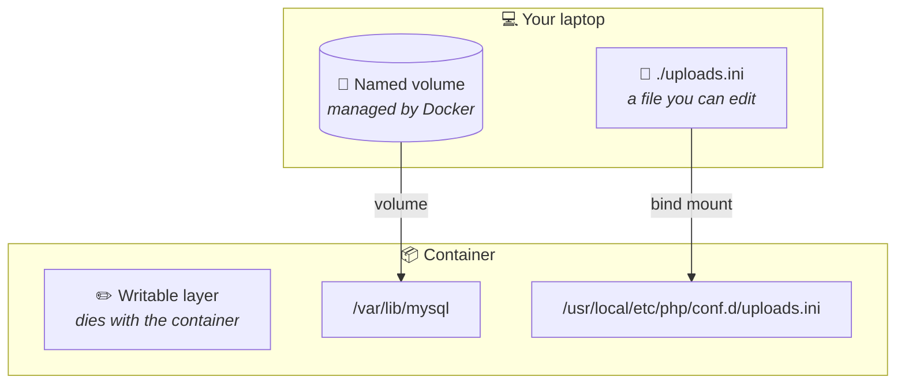
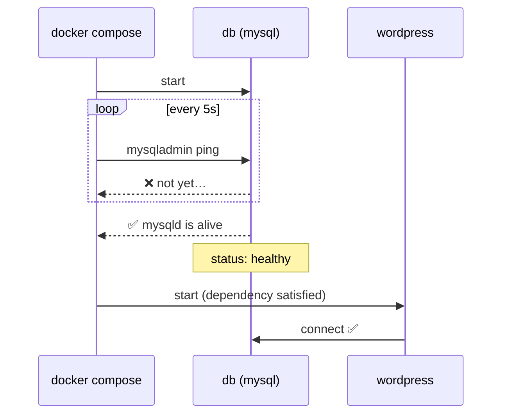

<p align="center"></p>

<p align="center">
  
  
  
</p>

> At the end of Lab 02 you deleted a container and your blog went with it. 💀 Today you make data **immortal**, and then you trade your 12-line `docker run` incantations for a single, readable file that launches your whole stack with **one command**.

<br>

## 🎯 Mission brief

| | You will… |
|---|---|
| 💾 | Store MySQL data in a **named volume** and prove it survives container death |
| 📂 | Use a **bind mount** to inject a config file from your laptop |
| 📝 | Rewrite the whole stack as a **`compose.yaml`** |
| 🔐 | Move secrets into a **`.env`** file |
| ❤️‍🩹 | Fix the startup race with a **healthcheck** + `depends_on` |
| 🔁 | Make containers self-heal with a **restart policy** |
| 🛠️ | **Your turn:** add a database admin UI with no step-by-step guide |

**Prerequisites:** Lab 02 done. You're comfortable with `docker run`, `-e`, `-p`, and networks.

---

## 🧠 Where can container data live?



| | **Writable layer** | **Named volume** | **Bind mount** |
|---|---|---|---|
| Survives `docker rm`? | ❌ | ✅ | ✅ |
| Who manages it? | Docker, per container | Docker | **You** (it's a normal folder/file) |
| Best for | Scratch/temp files | **Databases**, uploads, app state | Config files, live-editing source code |
| Syntax | (default) | `-v my-vol:/path` | `-v "$PWD/file":/path` |

---

## 🧹 Step 0 · Clean slate

```bash
docker rm -f wordpress wp-mysql 2>/dev/null
docker network rm my-wp 2>/dev/null
mkdir -p ~/docker-labs/lab03 && cd ~/docker-labs/lab03
```

---

## 💾 Part 1 · Named volumes: data that won't die

### Step 1 · Create a volume

```bash
docker volume create wp-db-data
docker volume ls
docker volume inspect wp-db-data
```

The `Mountpoint` shows where Docker keeps it (inside Docker's VM on Mac/Windows; you don't need to touch it directly).

### Step 2 · Run MySQL with the volume attached

Same as Lab 02, plus **one flag**. Note we also **pin a version** this time (more on that below):

```bash
docker network create my-wp

docker run --name wp-mysql \
  -e MYSQL_ROOT_PASSWORD=root -e MYSQL_DATABASE=wp \
  -e MYSQL_USER=user -e MYSQL_PASSWORD=admin \
  -v wp-db-data:/var/lib/mysql \
  --net=my-wp -d mysql:8.4

docker run --name wordpress \
  -e WORDPRESS_DB_HOST=wp-mysql:3306 -e WORDPRESS_DB_USER=user \
  -e WORDPRESS_DB_PASSWORD=admin -e WORDPRESS_DB_NAME=wp \
  --net=my-wp -p 8080:80 -d wordpress:7.1-php8.3-apache
```

`-v wp-db-data:/var/lib/mysql` means: *"whatever MySQL writes to `/var/lib/mysql`, actually store it in the `wp-db-data` volume."*

> [!IMPORTANT]
> **Why `mysql:8.4` instead of `mysql:latest`?** `latest` moves. Today's `latest` can be a different major version next month, and a database that was written by a newer version often **refuses to start** on an older one (and vice versa). `8.4` is MySQL's Long-Term Support line. **Pin your versions** whenever data is involved.

### Step 3 · Install WordPress and publish a post

Open <http://localhost:8080>, run through the installer, and publish a post titled **"I will survive 🪩"**.

### Step 4 · The murder test 🔪

```bash
docker rm -f wp-mysql
```

Refresh the site: *"Error establishing a database connection."* The database container is gone. Now bring it back **with the same volume**:

```bash
docker run --name wp-mysql \
  -e MYSQL_ROOT_PASSWORD=root -e MYSQL_DATABASE=wp \
  -e MYSQL_USER=user -e MYSQL_PASSWORD=admin \
  -v wp-db-data:/var/lib/mysql \
  --net=my-wp -d mysql:8.4
```

Wait ~10 seconds and refresh.

🪩 **Your post survived.** The container is brand-new (check `docker ps`: new ID, "Up X seconds"), but the data never lived in the container. It lived in the volume.

> [!TIP]
> Notice that the second boot was *faster*? MySQL saw an already-initialised data directory and skipped first-time setup. That's also why changing `MYSQL_PASSWORD` later has **no effect** on an existing volume: those env vars only apply on the very first boot.

---

## 📂 Part 2 · Bind mounts: inject files from your laptop

WordPress's default upload limit is small. In the admin, go to **Media → Add New Media File** and note the *"Maximum upload file size"*. Let's raise it **without building a new image**.

### Step 5 · Create a PHP config file on your laptop

Create `uploads.ini` in `~/docker-labs/lab03`:

```ini
file_uploads = On
upload_max_filesize = 64M
post_max_size = 64M
memory_limit = 256M
max_execution_time = 300
```

### Step 6 · Mount it into the container

PHP inside the image loads every `.ini` in `/usr/local/etc/php/conf.d/`. We'll place ours there:

```bash
docker rm -f wordpress
docker run --name wordpress \
  -e WORDPRESS_DB_HOST=wp-mysql:3306 -e WORDPRESS_DB_USER=user \
  -e WORDPRESS_DB_PASSWORD=admin -e WORDPRESS_DB_NAME=wp \
  -v "$PWD/uploads.ini":/usr/local/etc/php/conf.d/uploads.ini:ro \
  --net=my-wp -p 8080:80 -d wordpress:7.1-php8.3-apache
```

> [!NOTE]
> - `$PWD` = your current folder. Bind mounts need an **absolute path** (on PowerShell use `${PWD}`).
> - `:ro` = **read-only**. The container can read the file but never change it. A good habit for config.

Verify from inside the container:

```bash
docker exec wordpress php -r 'echo ini_get("upload_max_filesize"), PHP_EOL;'
```

`64M` ✅. Refresh **Media → Add New Media File**: *"Maximum upload file size: 64 MB."*

🤯 Wait, we deleted and recreated the WordPress container. **Why is the site still installed?** (Think about it, then expand.)

<details>
<summary>💡 Answer</summary>

Because all of WordPress's *state* (posts, users, settings, the "installed" flag) lives in **MySQL**, and MySQL's data is in the volume. The WordPress container itself is almost stateless. That's a pattern you'll lean on hard in Kubernetes: **stateless app containers, stateful data in volumes.**

(Uploaded images *do* live in the WordPress container's `/var/www/html/wp-content/uploads`, which is why Compose will give WordPress a volume too.)
</details>

### 🧹 Clean up Part 1–2

You're about to replace all of this with something much nicer:

```bash
docker rm -f wordpress wp-mysql
docker network rm my-wp
docker volume rm wp-db-data
```

---

## 📝 Part 3 · Docker Compose: your whole stack in one file

Count the flags you've typed today. 😮‍💨 Every one of those flags is configuration, and configuration belongs in a **file**, in **Git**, reviewed like code. Enter **Docker Compose**.

### Step 7 · Translate `docker run` → YAML

Create `compose.yaml` in `~/docker-labs/lab03`:

```yaml
name: wp-lab

services:
  db:                                  # ← service name = DNS name on the network
    image: mysql:8.4
    environment:
      MYSQL_ROOT_PASSWORD: root
      MYSQL_DATABASE: wp
      MYSQL_USER: user
      MYSQL_PASSWORD: admin
    volumes:
      - db-data:/var/lib/mysql

  wordpress:
    image: wordpress:7.1-php8.3-apache
    ports:
      - "8080:80"
    environment:
      WORDPRESS_DB_HOST: db:3306       # ← "db", the service name above
      WORDPRESS_DB_USER: user
      WORDPRESS_DB_PASSWORD: admin
      WORDPRESS_DB_NAME: wp
    volumes:
      - wp-data:/var/www/html
      - ./uploads.ini:/usr/local/etc/php/conf.d/uploads.ini:ro

volumes:                               # ← named volumes are declared here
  db-data:
  wp-data:
```

Every line maps to something you already know:

| `docker run` flag | `compose.yaml` |
|---|---|
| `--name wp-mysql` | the service key, `db:` |
| `-e KEY=value` | `environment:` |
| `-p 8080:80` | `ports:` |
| `-v vol:/path` | `volumes:` (+ top-level `volumes:`) |
| `-v "$PWD/file":/path` | `volumes: - ./file:/path` (relative paths work!) |
| `docker network create` + `--net` | 🎁 **free**. Compose creates a network for the project automatically |

### Step 8 · Launch!

```bash
docker compose up -d
```

```text
[+] Running 5/5
 ✔ Network wp-lab_default        Created
 ✔ Volume "wp-lab_db-data"       Created
 ✔ Volume "wp-lab_wp-data"       Created
 ✔ Container wp-lab-db-1         Started
 ✔ Container wp-lab-wordpress-1  Started
```

One command: a network, two volumes, two containers. 🎉 Explore your new remote control:

```bash
docker compose ps                 # what's running in THIS project
docker compose logs -f wordpress  # follow one service's logs (Ctrl+C to exit)
docker compose exec db mysql -uuser -padmin wp -e "SHOW TABLES;"
docker compose top                # processes in every container
```

Visit <http://localhost:8080>. Quick: did you get *"Error establishing a database connection"* for the first few seconds? Hold that thought. 👇

---

## ❤️‍🩹 Part 4 · Healthchecks: fixing the startup race

Compose started `db` and `wordpress` at the **same time**. WordPress is ready in ~1 second; MySQL needs ~15. For that gap, WordPress is talking to a database that isn't listening yet.

**"Started" ≠ "ready".** A **healthcheck** teaches Docker how to tell the difference.

### Step 9 · Teach Docker what "healthy" means for MySQL

Update the `db` and `wordpress` services:

```yaml
services:
  db:
    image: mysql:8.4
    # ...environment & volumes unchanged...
    healthcheck:
      test: ["CMD", "mysqladmin", "ping", "-h", "127.0.0.1", "-uroot", "-proot"]
      interval: 5s        # check every 5s
      timeout: 5s         # give up on a single check after 5s
      retries: 10         # 10 failures in a row = unhealthy
      start_period: 20s   # grace period: failures here don't count

  wordpress:
    image: wordpress:7.1-php8.3-apache
    depends_on:
      db:
        condition: service_healthy   # ⏳ don't start until db is HEALTHY
    # ...rest unchanged...
```

### Step 10 · Watch it work

```bash
docker compose down
docker compose up -d
docker compose ps
```

Run `docker compose ps` a few times quickly. You'll see `db` go `health: starting` → `healthy`, and **only then** does `wordpress` start.



> [!TIP]
> Debug a sick container with `docker inspect --format '{{json .State.Health}}' wp-lab-db-1`. It shows the output of the last few checks. **You'll need this trick in Lab 05.** 😉

---

## 🔐 Part 5 · Get secrets out of the YAML

`compose.yaml` belongs in Git. Passwords do **not**. Compose automatically reads a file named `.env` next to it and substitutes `${VARIABLES}`.

### Step 11 · Create `.env`

```dotenv
MYSQL_ROOT_PASSWORD=super-secret-root
MYSQL_DATABASE=wp
MYSQL_USER=wpuser
MYSQL_PASSWORD=wp-pass-123
WP_PORT=8080
```

### Step 12 · Reference the variables

```yaml
  db:
    environment:
      MYSQL_ROOT_PASSWORD: ${MYSQL_ROOT_PASSWORD}
      MYSQL_DATABASE: ${MYSQL_DATABASE}
      MYSQL_USER: ${MYSQL_USER}
      MYSQL_PASSWORD: ${MYSQL_PASSWORD}
    healthcheck:
      test: ["CMD", "mysqladmin", "ping", "-h", "127.0.0.1", "-uroot", "-p${MYSQL_ROOT_PASSWORD}"]
      # ...

  wordpress:
    ports:
      - "${WP_PORT:-8080}:80"          # ← ":-8080" = default if WP_PORT is unset
    environment:
      WORDPRESS_DB_HOST: db:3306
      WORDPRESS_DB_USER: ${MYSQL_USER}
      WORDPRESS_DB_PASSWORD: ${MYSQL_PASSWORD}
      WORDPRESS_DB_NAME: ${MYSQL_DATABASE}
```

See the final result Compose will actually run, with every variable filled in:

```bash
docker compose config
```

> [!WARNING]
> You changed the DB credentials, but the `db-data` volume was initialised with the **old** ones (remember the tip in Step 4?). Start fresh: `docker compose down -v && docker compose up -d`. The `-v` deletes the project's volumes, so only do this when you *mean* it.
>
> In a real repo, add `.env` to `.gitignore` and commit a `.env.example` with dummy values instead.

---

## 🔁 Part 6 · Restart policies: self-healing containers

Add `restart: unless-stopped` to **both** services:

```yaml
  db:
    image: mysql:8.4
    restart: unless-stopped
  wordpress:
    image: wordpress:7.1-php8.3-apache
    restart: unless-stopped
```

```bash
docker compose up -d                       # Compose applies only what changed
docker compose exec wordpress kill 1       # 💥 simulate a crash: kill PID 1
docker compose ps                          # ...it's back, with a fresh uptime
```

| Policy | Restarts after a crash? | Restarts when Docker/laptop reboots? |
|---|---|---|
| `no` (default) | ❌ | ❌ |
| `on-failure` | ✅ (non-zero exit only) | ✅ |
| `always` | ✅ | ✅ (even if you stopped it manually) |
| `unless-stopped` | ✅ | ✅ (unless *you* stopped it) |

> [!TIP]
> **Kubernetes preview 🔮.** Restart policies are the baby version of Kubernetes' superpower: *reconciliation*. K8s constantly compares "what should be running" with "what is running" and fixes any difference, across a whole cluster.

---

## 🧭 Part 7 · The lifecycle cheat sheet

Run each one and see what survives:

| Command | Containers | Network | Volumes (your data) |
|---|---|---|---|
| `docker compose stop` | ⏸️ stopped | ✅ kept | ✅ kept |
| `docker compose start` | ▶️ started again | ✅ | ✅ |
| `docker compose down` | 🗑️ removed | 🗑️ removed | ✅ **kept** |
| `docker compose down -v` | 🗑️ removed | 🗑️ removed | 🔥 **deleted** |

Prove it: publish a post → `docker compose down` → `docker compose up -d` → your post is still there. 🪩

---

## 🛠️ Your turn: add a database admin UI

Time to fly solo. 🦅 **No copy-paste this time.**

**Goal:** add a third service to your stack running **[Adminer](https://hub.docker.com/_/adminer)**, a lightweight web UI for databases, and use it to browse your WordPress tables.

**Acceptance criteria:**

- [ ] `docker compose up -d` starts **three** services
- [ ] Adminer is reachable at <http://localhost:8082>
- [ ] The login form's *Server* field is **pre-filled** with your database host
- [ ] Adminer doesn't start until the database is healthy
- [ ] You can log in with your `.env` credentials and find your post in `wp_posts`

<details>
<summary>💡 Hint 1: Where do I start?</summary>

Read the Adminer page on Docker Hub. Find out (a) which **port** Adminer listens on inside the container and (b) which **environment variable** sets the default server. Then pick a tag rather than `latest`.
</details>

<details>
<summary>💡 Hint 2: Which port mapping?</summary>

Adminer listens on **8080** inside its container. Your laptop's 8080 is already taken by WordPress, so map a *different host port* to Adminer's 8080. Remember: `HOST:CONTAINER`.
</details>

<details>
<summary>💡 Hint 3: What's the database "server" name?</summary>

From Adminer's point of view, the DB is just another container on the same Compose network. What name did WordPress use to reach it?
</details>

<details>
<summary>💡 Hint 4: The env var name</summary>

It's `ADMINER_DEFAULT_SERVER`. You'll also want the same `depends_on` + `condition` pattern you gave WordPress.
</details>

<details>
<summary>💡 Hint 5: Logging in</summary>

System: **MySQL / MariaDB** · Server: (pre-filled) · Username/Password: `MYSQL_USER` / `MYSQL_PASSWORD` from your `.env` · Database: `MYSQL_DATABASE`. Then click `wp_posts` → **Select data**.
</details>

---

## 🧹 Clean up

```bash
docker compose down        # keep the data for later…
# docker compose down -v   # …or nuke everything, including volumes
```

---

## 🏁 Checkpoint

- [ ] I killed a database container and my data survived (thanks, volumes)
- [ ] I bind-mounted a config file read-only and verified it inside the container
- [ ] My whole stack is described in `compose.yaml` and starts with one command
- [ ] WordPress waits for a **healthy** database
- [ ] Secrets live in `.env`, not in the YAML
- [ ] A crashed container restarts itself
- [ ] I added Adminer on my own 🦅

## 🤔 Quick quiz

<details>
<summary><b>1.</b> You run <code>docker compose down</code>, then <code>up</code>. Is your blog still there? What about after <code>down -v</code>?</summary>

After `down`: yes, volumes are kept. After `down -v`: no, volumes are deleted along with your data.
</details>

<details>
<summary><b>2.</b> You change <code>MYSQL_PASSWORD</code> in <code>.env</code> and run <code>up -d</code>. WordPress can't connect anymore. Why?</summary>

The `MYSQL_*` init variables only run on the **first boot with an empty data directory**. The existing volume still has the old password. WordPress got the new one. Either change the password in MySQL with SQL, or (in dev) reset with `down -v`.
</details>

<details>
<summary><b>3.</b> Named volume or bind mount for a production database? For your app's source code during development?</summary>

**Named volume** for the database (Docker-managed, portable, no host-path assumptions). **Bind mount** for source code in development (edit on your laptop, see changes instantly in the container).
</details>

---

<p align="center">
  <b>Next up →</b> <a href="../04-build-your-own-image/README.md"><b>Lab 04 · Build Your Own Image</b></a>: stop only <i>using</i> other people's images and start <i>shipping</i> your own.
</p>
