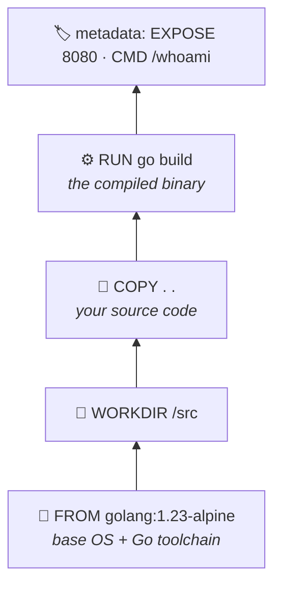
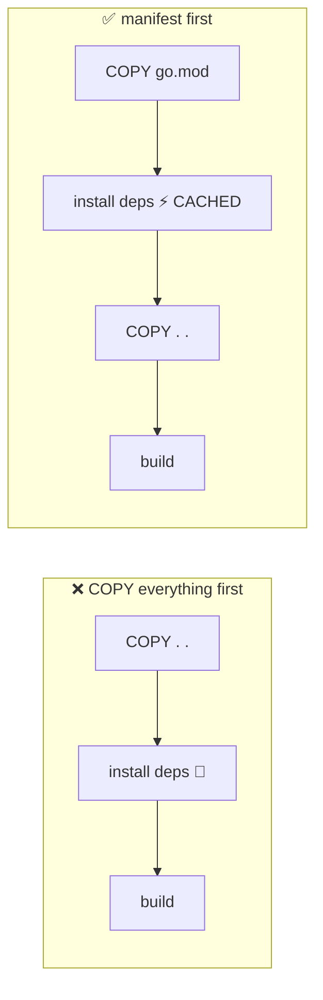
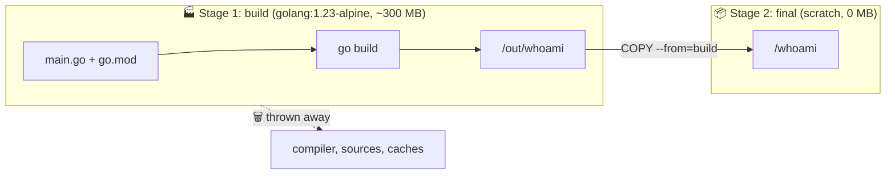
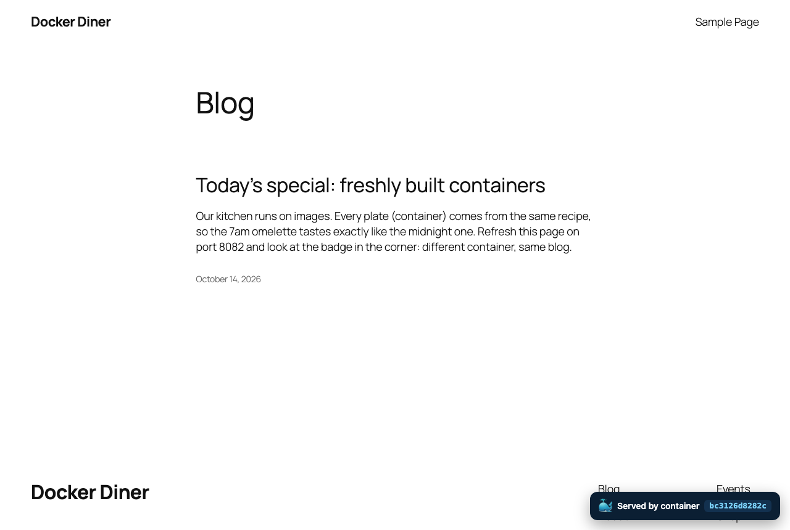

<p align="center"></p>

<p align="center">
  
  
  
</p>

> So far you've been a **customer** at the Docker restaurant, ordering images other people cooked. Today you step into the kitchen. 👩‍🍳 You'll write your own recipes (**Dockerfiles**), learn why the order of lines matters, shrink an image by **98%**, and bake a custom feature into WordPress itself.

<br>

## 🎯 Mission brief

| | You will… |
|---|---|
| 📜 | Write a **Dockerfile** from scratch for a tiny Go web app |
| 🧅 | Peel back **layers** and make the **build cache** work for you |
| 🙈 | Keep junk out of your image with **`.dockerignore`** |
| 🏋️➡️🪶 | Use a **multi-stage build** to go from ~330 MB to ~5 MB |
| 🛡️ | Run as **non-root** and add a built-in **`HEALTHCHECK`** |
| 🎛️ | Stamp versions in with **`ARG`** and configure with **`ENV`** |
| 🧩 | **Extend** the official WordPress image and run **two replicas** with Compose |
| 🛠️ | **Your turn:** ship v2 alongside v1 with no step-by-step guide |

**Prerequisites:** Labs 01–03. You **don't** need Go installed. That's kind of the point. 😉

---

## 🧹 Step 0 · Get into position

```bash
docker compose -p wp-lab down 2>/dev/null   # stop Lab 03's stack if it's still running
cd docker-k8s-labs/labs/04-build-your-own-image
ls -R
```

```text
badge/
  container-badge.php      ← a tiny WordPress plugin (Part D)
whoami/
  go.mod
  main.go                  ← a tiny web server that says which container answered
```

Take 60 seconds to read `whoami/main.go`. It serves a whale 🐳, a message, the container's **hostname**, a **version**, and its **uptime**. It also has a `/healthz` endpoint and a `-health` flag. Remember those.

---

## 🧠 What is a Dockerfile, really?

A Dockerfile is a **recipe**: a list of instructions, run top to bottom, where **each instruction produces a layer**. The finished image is those layers stacked up, plus some metadata (which port, which command to run…).



| Instruction | What it does | Makes a layer? |
|---|---|---|
| `FROM` | Start from an existing image | ✅ (the base) |
| `WORKDIR` | `cd` (and `mkdir -p`) for the rest of the build | tiny |
| `COPY` | Copy files from your folder (the **build context**) into the image | ✅ |
| `RUN` | Run a command *at build time* and keep the result | ✅ |
| `ENV` | Set an environment variable for build **and** runtime | metadata |
| `ARG` | A variable for **build time only** (`--build-arg`) | metadata |
| `EXPOSE` | Document which port the app listens on | metadata |
| `USER` | Switch to a (non-root!) user | metadata |
| `HEALTHCHECK` | How Docker checks the app is healthy | metadata |
| `CMD` / `ENTRYPOINT` | What runs when a container *starts* | metadata |

---

## 📜 Part A · Your first Dockerfile

### Step 1 · Write it

Create `whoami/Dockerfile`:

```dockerfile
FROM golang:1.23-alpine

WORKDIR /src
COPY . .
RUN go build -o /whoami .

EXPOSE 8080
CMD ["/whoami"]
```

Five lines. You're telling Docker: *"Start from an image that has Go. Copy my code in. Compile it. When someone runs this, start the binary."*

### Step 2 · Build it

```bash
docker build -t whoami:fat ./whoami
```

- `-t whoami:fat` → **tag** the result as repository `whoami`, tag `fat`
- `./whoami` → the **build context**: the folder whose files `COPY` can see

### Step 3 · Run it

```bash
docker run -d --name who-fat -p 8090:8080 whoami:fat
curl localhost:8090        # or open http://localhost:8090 in your browser
```

```text
        ##         .
  ## ## ##        ==
 ## ## ## ##     ===
/"""""""""""""""\___/ ===
{                      /  ===-
\______ o           __/
  \    \         __/
   \____\_______/

  Hello from inside a container!

  hostname : 4c1a9e0b7f2d
  version  : dev
  uptime   : 3s
```

🎉 **You built and shipped your first image.** You never installed Go; the compiler lived in the image.

### Step 4 · Weigh it ⚖️

```bash
docker images whoami
```

```text
REPOSITORY   TAG   IMAGE ID       CREATED          SIZE
whoami       fat   d8c16f30928c   30 seconds ago   326MB
```

**326 MB** for a ~6 MB program?! 🐘 Hold that thought. We'll fix it in Part C.

---

## 🧅 Part B · Layers & the build cache

### Step 5 · See the layers

```bash
docker history whoami:fat
```

Each row is a layer, newest on top, with its size. Most of the bulk is the Go toolchain from `FROM golang:1.23-alpine`.

### Step 6 · Feel the cache

Build again, changing nothing:

```bash
docker build -t whoami:fat ./whoami
```

Instant. Every step says `CACHED`. Docker remembers each layer and reuses it **as long as nothing that layer depends on has changed**.

Now edit `main.go` and change the default message (`"Hello from inside a container!"` → anything you like), then rebuild and watch which steps re-run.

> [!IMPORTANT]
> **The golden rule of the cache:** once one layer changes, **every layer after it is rebuilt too.** `COPY . .` copies *everything*, so touching any file invalidates it, and every step after it.

### Step 7 · Order for speed

Real apps have dependencies that take minutes to download. You don't want to redownload them every time you edit one line of code. The trick: **copy the dependency manifest first, install, *then* copy the rest.**

```dockerfile
FROM golang:1.23-alpine

WORKDIR /src
COPY go.mod ./            # 1️⃣ only the dependency list
RUN go mod download       # 2️⃣ cached until go.mod changes
COPY . .                  # 3️⃣ your code (changes often)
RUN go build -o /whoami .

EXPOSE 8080
CMD ["/whoami"]
```



> [!NOTE]
> Same idea in every language: `package.json` → `npm ci`, `requirements.txt` → `pip install`, `pom.xml` → `mvn dependency:go-offline`. Our toy app has no dependencies, so the speedup is tiny here, but in a real project this saves minutes on every build.

### Step 8 · `.dockerignore`: keep junk out

`COPY . .` sends **everything** in the build context to Docker: `.git`, local secrets, build output, `node_modules`... Create `whoami/.dockerignore`:

```gitignore
.git
*.md
Dockerfile*
.dockerignore
.env
```

Smaller context → faster builds, smaller images, and no accidentally shipped secrets. 🔐

---

## 🏋️➡️🪶 Part C · Multi-stage builds: the 98% diet

**The problem:** you need a 300 MB toolchain to **build** the app, but only a ~5 MB binary to **run** it.

**The solution:** use *two* `FROM`s. Build in a big "workshop" image, then copy **only the result** into a tiny "shipping" image. Everything else is left behind.



### Step 9 · Rewrite `whoami/Dockerfile`

```dockerfile
# syntax=docker/dockerfile:1

# ---------- Stage 1: the workshop ----------
FROM golang:1.23-alpine AS build
WORKDIR /src
COPY go.mod ./
RUN go mod download
COPY . .
ARG VERSION=v1
RUN CGO_ENABLED=0 go build -ldflags "-s -w -X main.version=${VERSION}" -o /out/whoami .

# ---------- Stage 2: the shipping box ----------
FROM scratch
COPY --from=build /out/whoami /whoami
USER 65532:65532
EXPOSE 8080
HEALTHCHECK --interval=10s --timeout=3s --start-period=3s --retries=3 CMD ["/whoami", "-health"]
ENTRYPOINT ["/whoami"]
```

What's new:

| Line | Why |
|---|---|
| `AS build` | Names the stage so a later stage can copy from it |
| `ARG VERSION=v1` | A build-time knob. Override with `--build-arg VERSION=v2` |
| `CGO_ENABLED=0 … -ldflags "-s -w -X main.version=…"` | A fully static binary (no C libraries needed), debug info stripped, version stamped in |
| `FROM scratch` | **Literally an empty image.** No shell, no OS, no package manager, almost nothing for an attacker to use |
| `COPY --from=build` | Grab one file from the build stage; leave the 300 MB behind |
| `USER 65532:65532` | Run as an unprivileged user, **not root** 🛡️ |
| `HEALTHCHECK … /whoami -health` | There's no `curl` in `scratch`, so the app checks itself |
| `ENTRYPOINT` | The binary *is* the container. Extra `docker run` args become its flags |

### Step 10 · Build, weigh, gloat

```bash
docker build -t whoami:v1 ./whoami
docker images whoami
```

```text
REPOSITORY   TAG   IMAGE ID       CREATED          SIZE
whoami       v1    85d301d9af3a   5 seconds ago    5.44MB
whoami       fat   d8c16f30928c   10 minutes ago   326MB
```

🪶 **326 MB → 5.4 MB. That's 60× smaller.** Faster pulls, faster deploys, faster scaling, and far less to patch.

### Step 11 · Run it and watch the health

```bash
docker rm -f who-fat
docker run -d --name who-v1 -p 8090:8080 whoami:v1
docker ps --filter name=who-v1      # STATUS: (health: starting) → (healthy) after ~10s
curl localhost:8090
```

Version now says `v1`, stamped in at build time. ✅

Try to get a shell inside it:

```bash
docker exec -it who-v1 sh
```

<details>
<summary>🤔 Why did that fail?</summary>

`exec: "sh": executable file not found`. There *is* no shell in a `scratch` image. That's a security feature: if an attacker breaks into your app, there's no shell, no `curl`, no package manager waiting for them. (For debugging, you'd use `docker debug` or a debug variant of the image.)
</details>

### Step 12 · Configure at runtime with `ENV`

The app reads a `MESSAGE` environment variable. **Same image, different behaviour, no rebuild:**

```bash
docker run --rm -d --name who-hi -p 8091:8080 -e MESSAGE="Ahoy from container two! 🏴‍☠️" whoami:v1
curl localhost:8091
docker rm -f who-hi
```

> [!TIP]
> **Build once, configure everywhere.** `ARG` bakes things into the image at build time (like a version). `ENV`/`-e` configure a container at run time (like a message or a DB password). The *same* image should move from dev → test → prod; only its configuration changes. Kubernetes leans on this hard with **ConfigMaps** and **Secrets**.

---

## 🧩 Part D · Extend an official image: WordPress with a twist

You don't always start from scratch. Most real Dockerfiles start `FROM` an official image and add one thing. Let's bake the **Container Badge** plugin (`badge/container-badge.php`) into WordPress. It shows which container served each page.

### Step 13 · Write `badge/Dockerfile`

```dockerfile
FROM wordpress:7.1-php8.3-apache

LABEL org.opencontainers.image.title="diner-wordpress" \
      org.opencontainers.image.description="WordPress with the Container Badge baked in"

# "Must-use" plugins load automatically. No clicking "Activate".
COPY container-badge.php /usr/src/wordpress/wp-content/mu-plugins/container-badge.php

ENV BADGE_MESSAGE="Served by container"
```

> [!NOTE]
> **Why `/usr/src/wordpress` and not `/var/www/html`?** The official image keeps a pristine copy of WordPress in `/usr/src/wordpress` and copies it into `/var/www/html` (a volume) on first start. Put your additions in the pristine copy and they come along for the ride. *Reading an image's docs and entrypoint script is half the job when extending it.*

### Step 14 · Run two replicas with Compose

Create `compose.yaml` in the `04-build-your-own-image` folder:

```yaml
name: diner

services:
  db:
    image: mysql:8.4
    environment:
      MYSQL_ROOT_PASSWORD: root
      MYSQL_DATABASE: wp
      MYSQL_USER: user
      MYSQL_PASSWORD: admin
    volumes:
      - db-data:/var/lib/mysql
    healthcheck:
      test: ["CMD", "mysqladmin", "ping", "-h", "127.0.0.1", "-uroot", "-proot"]
      interval: 5s
      timeout: 5s
      retries: 10
      start_period: 20s

  wp-a: &wordpress                  # ← a YAML anchor: "remember this block as 'wordpress'"
    build: ./badge                  # ← build the image from badge/Dockerfile…
    image: diner-wordpress:1.0      # ← …and tag it with this name
    depends_on:
      db:
        condition: service_healthy
    environment:
      WORDPRESS_DB_HOST: db
      WORDPRESS_DB_USER: user
      WORDPRESS_DB_PASSWORD: admin
      WORDPRESS_DB_NAME: wp
      WORDPRESS_CONFIG_EXTRA: |
        define('WP_HOME',    'http://' . $$_SERVER['HTTP_HOST']);
        define('WP_SITEURL', 'http://' . $$_SERVER['HTTP_HOST']);
    ports:
      - "8081:80"

  wp-b:
    <<: *wordpress                  # ← paste everything from wp-a…
    ports:
      - "8082:80"                   # ← …but override the port

volumes:
  db-data:
```

Three new tricks in there:

1. **`build:` + `image:`**: Compose builds your Dockerfile and tags the result.
2. **YAML anchors (`&` / `<<: *`)**: Don't repeat yourself. `wp-b` is a copy of `wp-a` with a different port.
3. **`WORDPRESS_CONFIG_EXTRA` with `$$`**: WordPress normally locks itself to one URL. These lines tell it *"use whatever host the browser asked for"*, so both ports work. The `$$` escapes the `$` so Compose doesn't try to substitute it as a variable.

```bash
docker compose up -d --build
docker compose ps
```

### Step 15 · Same blog, different containers

Install WordPress at <http://localhost:8081> and publish a post. Then open <http://localhost:8082>.

<table>
<tr>
<td align="center"><b>localhost:8081</b> (wp-a)</td>
<td align="center"><b>localhost:8082</b> (wp-b)</td>
</tr>
<tr>
<td></td>
<td></td>
</tr>
</table>

👀 Look at the **badge in the bottom-right**: two different container IDs, the **same posts**. Two stateless app containers share one stateful database. **This is exactly how apps scale horizontally**, and it's precisely the shape Kubernetes is built to run.

> [!WARNING]
> Each replica here has its *own* `/var/www/html`, so a picture uploaded via wp-a won't exist on wp-b. Real deployments put uploads in shared storage (or object storage like S3). Stateless containers are easy to scale; shared files are the hard part.

---

## 🏷️ Part E · Tags & registries (sharing your image)

An image name has up to four parts:

```text
docker.io / varoon / whoami : v1
└registry┘ └ user ┘ └ repo ┘ └tag┘
```

Leave out the registry and Docker assumes `docker.io` (Docker Hub). Leave out the tag and it assumes `latest`.

**Optional: push to Docker Hub** (needs a free account):

```bash
docker login
docker tag whoami:v1 <your-dockerhub-username>/whoami:v1
docker push <your-dockerhub-username>/whoami:v1
```

Now *anyone* can `docker run -p 8090:8080 <your-dockerhub-username>/whoami:v1`. 🌍 And a Kubernetes cluster can too. That's how your code gets from your laptop into K8s.

> [!TIP]
> Notice how fast that push was? 5 MB. Imagine pushing (and pulling on every node, on every deploy) the 326 MB version instead. 🐘

---

## 🛠️ Your turn: ship v2 🚢

A product manager bursts in: *"We need **v2** with a new message, and v1 must keep running for existing customers while we test it!"* 🏃‍♀️💨

**No step-by-step this time.** Here's what "done" looks like:

- [ ] An image tagged **`whoami:v2`** exists, and its output says **`version : v2`**, **without editing any `.go` file**
- [ ] **v1 and v2 run at the same time**, on host ports **8090** and **8091**
- [ ] v2 displays a custom message of your choice, **set at run time** (not baked into the image)
- [ ] Both containers report **`(healthy)`** in `docker ps`
- [ ] `docker images whoami` shows **`v1` and `v2` are the same size** (and you can explain why)
- [ ] 🌟 **Stretch:** add a `whoami` service to your Part D `compose.yaml` that **builds** from `./whoami` with `VERSION=v2` and is reachable at <http://localhost:8093>

<details>
<summary>💡 Hint 1: Changing the version without touching code</summary>

Look at your Dockerfile. Which instruction declares a build-time variable with a default of `v1`? `docker build --help` lists a flag to override it.
</details>

<details>
<summary>💡 Hint 2: The exact build flag</summary>

`--build-arg NAME=value`. Don't forget `-t` to tag the result `whoami:v2`.
</details>

<details>
<summary>💡 Hint 3: Running both</summary>

Two `docker run` commands, two `--name`s, two different **host** ports. The **container** port is 8080 in both. Remember Lab 01? 😉
</details>

<details>
<summary>💡 Hint 4: The run-time message</summary>

Read `main.go`: which environment variable does it check? Pass it with `-e`.
</details>

<details>
<summary>💡 Hint 5: Why the same size?</summary>

What actually differs between the two builds? (A few bytes of a version string inside the binary.)
</details>

<details>
<summary>💡 Hint 6 (stretch): Build args in Compose</summary>

`build:` can be a string (just the path) **or** a block with `context:` and `args:`. Check the Compose docs for `build.args`.
</details>

---

## 🧹 Clean up

```bash
docker rm -f who-v1 who-v2 2>/dev/null
docker compose down -v
```

---

## 🏁 Checkpoint

- [ ] I wrote a Dockerfile and can explain every instruction in it
- [ ] I can predict which layers rebuild when I edit a file
- [ ] I shrank an image ~60× with a multi-stage build
- [ ] My final image runs as non-root and reports its own health
- [ ] I used `ARG` for build-time values and `ENV` for run-time config
- [ ] I extended an official image and ran two replicas sharing one DB
- [ ] I shipped v2 next to v1 on my own 🚢

## 🤔 Quick quiz

<details>
<summary><b>1.</b> You edit only <code>main.go</code>. With the "manifest first" Dockerfile, which steps re-run?</summary>

`COPY . .` and everything after it (the `go build`, then the final stage's `COPY --from`). `COPY go.mod` and `RUN go mod download` stay `CACHED`.
</details>

<details>
<summary><b>2.</b> What's the difference between <code>ARG</code> and <code>ENV</code>?</summary>

`ARG` exists only **during the build** (set with `--build-arg`). `ENV` is baked into the image and exists **at run time** too (overridable with `-e`). Never put secrets in either; they're visible in `docker history` / `docker inspect`.
</details>

<details>
<summary><b>3.</b> Name three benefits of a tiny final image.</summary>

Faster pulls and deploys · less disk and bandwidth · smaller attack surface (no shell or tools for an attacker) · fewer CVEs to patch · faster scale-out when Kubernetes starts new copies on fresh nodes.
</details>

<details>
<summary><b>4.</b> Why did the badge show different hostnames on ports 8081 and 8082?</summary>

Each container gets its own hostname, which defaults to its container ID. Two containers, two hostnames, even though they came from the same image.
</details>

---

<p align="center">
  <b>Next up →</b> <a href="../05-challenge-rescue-mission/README.md"><b>Lab 05 · 🔥 Rescue Mission (Challenge)</b></a>: everything you've learned, no hand-holding.
</p>
