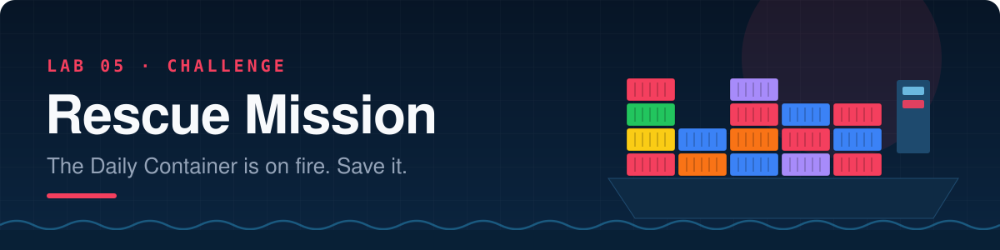

<p align="center"></p>

<p align="center">
  
  
  
</p>

```text
📟  PAGER ALERT · 06:47 · SEV-1
────────────────────────────────────────────────────────────────
Service:   The Daily Container (newsroom CMS)
Status:    DOWN
Message:   Morning edition goes to print at 09:00. Site won't start.
           Previous engineer has left the company. Their last commit:
           "it worked on my machine. mostly. good luck 🫡"
On call:   YOU
────────────────────────────────────────────────────────────────
```

> **This is a challenge lab.** No copy-paste commands, no step-by-step. You get a broken stack, a list of missions, and **hints you can unlock if you're stuck**. Every concept you need was covered in Labs 01–04. Grab a coffee ☕ and put on your detective hat 🕵️.

<br>

## 🏆 Scoring

Each mission is worth **XP**. Each hint you open costs **−2 XP** (be honest! 😇). Track your score as you go.

| Mission | XP |
|---|---|
| 🚑 1 · Stop the bleeding | 40 |
| 🗞️ 2 · The printing press test | 20 |
| 🧪 3 · A staging newsroom | 20 |
| 📡 4 · Scale the wire service | 20 |
| 🥠 Boss · The fortune cookie diet | 40 |
| 🌟 Bonus · Finish a mission with zero hints | +5 each |

<table>
<tr><th>Final score</th><th>Your rank</th></tr>
<tr><td>0–59</td><td>⚓ Deckhand: you kept the ship afloat</td></tr>
<tr><td>60–99</td><td>🧭 First Mate: the crew trusts you</td></tr>
<tr><td>100–139</td><td>👨‍✈️ Captain: you run this harbour</td></tr>
<tr><td>140+</td><td>🏴‍☠️ Admiral of the Fleet: Kubernetes fears you</td></tr>
</table>

---

## 🧰 Your investigation toolkit

You already know all of these. Use them relentlessly:

```bash
docker compose ps                     # who's up, who's not, who's (un)healthy
docker compose logs <service>         # what did it say before it died?
docker compose config                 # the YAML after Compose has processed it
docker compose exec <service> <cmd>   # run something inside a running container
docker inspect --format '{{json .State.Health}}' <container>   # why is it unhealthy?
docker network inspect <network>      # who's on which network?
docker images                         # how big is that image, really?
```

> [!TIP]
> **Change one thing at a time**, then `docker compose up -d` again. Compose only recreates what changed. Fixing five things at once and having it still fail teaches you nothing.

---

## 📦 Setup

```bash
cd docker-k8s-labs/labs/05-challenge-rescue-mission/starter
ls -R
```

```text
compose.yaml          ← the crime scene 🔍
fortune/
  app.py              ← Boss level
  Dockerfile          ← Boss level (yikes)
  requirements.txt
```

> [!IMPORTANT]
> The `whoami` service builds from **your Lab 04 work** (`../../04-build-your-own-image/whoami`), so you need the multi-stage `whoami/Dockerfile` you wrote there. Skipped Lab 04? Go write it now; it's worth it.

Stop anything from earlier labs that might be holding ports **8080, 8081, 8090 or 5000**:

```bash
docker ps --format 'table {{.Names}}\t{{.Ports}}'
```

---

## 🚑 Mission 1 · Stop the bleeding (40 XP)

Run it and watch it fail:

```bash
docker compose up -d
```

The previous engineer left **five** bugs in `compose.yaml` that keep the newsroom offline. Find and fix them all.

**✅ Done when:**

- [ ] `docker compose up -d` completes with **no errors**
- [ ] `docker compose ps` shows `db` as **healthy** and `wordpress` + `whoami` as **Up**
- [ ] <http://localhost:8080> shows the WordPress installer (**8080** on your laptop)
- [ ] You complete the install with site title **"The Daily Container"**
- [ ] You can write down each bug and how you found it (you'll want this for the retro)

<details>
<summary>💡 Hint 1.1: Where do I even start? (−2 XP)</summary>

Read the **first** error carefully. `dependency failed to start: container rescue-db-1 is unhealthy` means WordPress never even tried. So the first bug is in `db`, and specifically in how Docker decides `db` is healthy. Which command can show you the output of a container's health checks?
</details>

<details>
<summary>💡 Hint 1.2: The health check (−2 XP)</summary>

`docker inspect --format '{{json .State.Health}}' rescue-db-1` shows the last few check results. Read the error message word by word, then compare the healthcheck `test:` to the one you wrote in Lab 03. Look *really* closely at the command name.
</details>

<details>
<summary>💡 Hint 1.3: The port (−2 XP)</summary>

Which port does Apache listen on **inside** the WordPress container? Which port do you want on **your laptop**? Which side of the colon is which? (`HOST:CONTAINER`)
</details>

<details>
<summary>💡 Hint 1.4: "Error establishing a database connection" (−2 XP)</summary>

Three separate things must all be true for WordPress to reach MySQL:

1. They share a **network**. Check the `networks:` of both services.
2. WordPress uses the right **hostname**. In Compose, what name does a service get on the network?
3. The **credentials** match *exactly*, character for character, on both sides.
</details>

<details>
<summary>💡 Hint 1.5: Prove the network theory (−2 XP)</summary>

`docker compose exec wordpress getent hosts db`: if this prints nothing, WordPress can't even *see* the database. Compare with `docker network inspect rescue_backend` and `rescue_frontend`.
</details>

---

## 🗞️ Mission 2 · The printing press test (20 XP)

The editor-in-chief doesn't trust containers. 😤 *"Prove the morning edition survives a restart."*

1. Publish a post titled **"BREAKING: Containers are disposable, data is not"**
2. Run `docker compose down` (**no** `-v`!)
3. Run `docker compose up -d`

**✅ Done when:**

- [ ] After `down` + `up`, the site is **still installed** and your post is **still there**
- [ ] You can explain what was wrong and why it lost data before your fix

<details>
<summary>💡 Hint 2.1: It asked me to install again! (−2 XP)</summary>

So the data didn't survive. There *is* a volume on `db`. But is it mounted where MySQL actually keeps its data? Where did MySQL store data in Lab 03?
</details>

<details>
<summary>💡 Hint 2.2: Prove it (−2 XP)</summary>

`docker compose exec db ls /var/lib/mysql` vs. the path in the YAML. A volume mounted at the wrong path is like a safe bolted to the wall next to the money. 💰
</details>

---

## 🧪 Mission 3 · A staging newsroom (20 XP)

The editors want a **staging** copy of the site to try new layouts without touching production.

**✅ Done when:**

- [ ] A second WordPress service, `wordpress-staging`, runs at <http://localhost:8081>
- [ ] It uses the **same MySQL server** (`db`) but its **own database** named `staging`
- [ ] It has its **own** `/var/www/html` volume (not shared with production)
- [ ] 🔑 **Fully automated:** after `docker compose down -v && docker compose up -d`, the `staging` database exists **with no manual commands**
- [ ] Production at <http://localhost:8080> is unaffected

*Partial credit (10 XP): staging works, but you created the database by hand.*

<details>
<summary>💡 Hint 3.1: The staging service itself (−2 XP)</summary>

It's almost a copy of `wordpress`. What has to be different? (The DB name, the host port, the volume, and the service name.) Don't forget to declare the new volume at the bottom of the file.
</details>

<details>
<summary>💡 Hint 3.2: Creating a database by hand (−2 XP)</summary>

`docker compose exec db mysql -uroot -p<root-password> -e "CREATE DATABASE staging; GRANT ALL PRIVILEGES ON staging.* TO 'editor'@'%';"`. That gets you partial credit. Now automate it…
</details>

<details>
<summary>💡 Hint 3.3: Automating it (−2 XP)</summary>

Read the **"Initializing a fresh instance"** section of the MySQL image docs on Docker Hub. There's a special directory: any `.sql` or `.sh` file you put in it runs on first boot. How could you get a file from your laptop into that directory? (Lab 03, Part 2…)
</details>

<details>
<summary>💡 Hint 3.4: My init script didn't run! (−2 XP)</summary>

Init scripts only run when MySQL starts with an **empty** data directory. Your volume already has data from Mission 2, so MySQL skips initialisation. You need to start fresh with `docker compose down -v` (yes, you'll redo the install; that's what staging is for 😅).
</details>

---

## 📡 Mission 4 · Scale the wire service (20 XP)

Breaking news means **traffic spikes**. The `whoami` "wire service" needs to run as **three identical replicas**.

**✅ Done when:**

- [ ] `docker compose ps` shows **three** healthy `whoami` containers
- [ ] The replica count lives **in `compose.yaml`**, so a plain `docker compose up -d` gives you 3
- [ ] From a throwaway container on the same network, the name `whoami` resolves to **three different IPs**
- [ ] Repeated requests to `http://whoami:8080` from inside the network are answered by **different hostnames**

<details>
<summary>💡 Hint 4.1: First try (−2 XP)</summary>

Try `docker compose up -d --scale whoami=3` and read the error. Think back to Lab 01, Step 6: why can't three containers share that setting?
</details>

<details>
<summary>💡 Hint 4.2: The port problem (−2 XP)</summary>

A fixed host port can only be bound **once**. Either remove the host port mapping entirely (the replicas are reachable *inside* the network anyway), or give Compose a **range** of host ports, like `"8090-8092:8080"`.
</details>

<details>
<summary>💡 Hint 4.3: Replicas in YAML (−2 XP)</summary>

Look up the `deploy:` → `replicas:` key in the Compose file reference.
</details>

<details>
<summary>💡 Hint 4.4: Testing from inside the network (−2 XP)</summary>

Compose names networks `<project>_<network>`; find yours with `docker network ls`. Then:
`docker run --rm --network <that-network> busybox nslookup whoami` and
`docker run --rm --network <that-network> curlimages/curl -s whoami:8080` (run that a few times).
</details>

> [!TIP]
> 🔮 **What you just built** (one name → many replicas, and Docker's DNS spreading clients across them) is a primitive version of a **Kubernetes Service**. K8s does it with real load balancing, health-aware routing, and replicas spread across many machines.

---

## 🥠 Boss level · The fortune cookie diet (40 XP)

The newsroom wants a **Fortune Cookie API** for the sidebar. A developer "containerised" it in `fortune/`. Their Dockerfile *works*… technically. 😬

Build it and see:

```bash
docker build -t fortune:bloated ./fortune
docker images fortune
```

**✅ Done when:**

- [ ] A `fortune` service in `compose.yaml` **builds** from `./fortune`
- [ ] `curl localhost:5000` **from your laptop** returns a JSON fortune 🥠
- [ ] The image is **under 100 MB** (`docker images` to check)
- [ ] The container does **not** run as root (`docker compose exec fortune whoami` must not say `root`)
- [ ] `docker compose ps` shows fortune as **(healthy)**, using a `HEALTHCHECK` defined **in the Dockerfile**
- [ ] A `.dockerignore` exists, and the `pip install` layer is **CACHED** when you change only `app.py`
- [ ] `CMD` uses **exec form** (`["…", "…"]`)

<details>
<summary>💡 Hint B.1: It's running but <code>curl</code> gets "Empty reply from server" (−2 XP)</summary>

Try it from **inside** the container: `docker exec <container> curl -s localhost:5000`. Works there?! Then the app is only listening for connections that come from *inside* the container. Look at the `host=` in `app.py`. Which address means "every network interface"?
</details>

<details>
<summary>💡 Hint B.2: Where does the bulk come from? (−2 XP)</summary>

`docker history fortune:bloated`. Two culprits: the **base image** (`python:3.12` is a full Debian with compilers) and the **"just in case"** packages. Does a pure-Python Flask app need `build-essential` or `vim`?
</details>

<details>
<summary>💡 Hint B.3: Smaller bases (−2 XP)</summary>

Check the tags on <https://hub.docker.com/_/python>: compare `python:3.12-slim` and `python:3.12-alpine`. Only one of them gets you under 100 MB comfortably. Also: `pip install --no-cache-dir` skips keeping pip's download cache in the layer.
</details>

<details>
<summary>💡 Hint B.4: Cache-friendly order (−2 XP)</summary>

Same trick as Lab 04, Step 7: copy `requirements.txt` **alone**, install, *then* copy `app.py`.
</details>

<details>
<summary>💡 Hint B.5: Non-root (−2 XP)</summary>

Create a user in a `RUN` step (on Alpine: `adduser -D -u 10001 <name>`), then switch to it with `USER`. Do this **after** installing packages (installing needs root).
</details>

<details>
<summary>💡 Hint B.6: A healthcheck without curl (−2 XP)</summary>

The slim image doesn't have `curl`, but it definitely has **Python**. Python's standard library can make an HTTP request to `/healthz` in one line with `urllib.request`. If it raises an exception, the check fails.
</details>

---

## 📝 Debrief

When you're done (or time's up), write a mini **incident retro** with your table:

| # | Symptom | Root cause | Fix | How I found it |
|---|---|---|---|---|
| 1 | | | | |
| 2 | | | | |
| … | | | | |

Then discuss:

1. Which bug was hardest to find, and which **command** cracked it?
2. Which bugs would a **linter** or **CI check** have caught before production?
3. Mission 4 hinted at Kubernetes Services. What *else* in this lab would you want an orchestrator to handle for you?

---

## 🧹 Clean up

```bash
docker compose down -v
```

<p align="center">
  🎓 <b>You've finished the Docker labs.</b> Total up your XP, claim your rank, and head to the<br>
  <a href="https://varoonsahgal.github.io/docker-k8s-labs/field-guide/#k8s-why"><b>Field Guide → Kubernetes chapters</b></a> to see where all of this is going. 🚀
</p>
